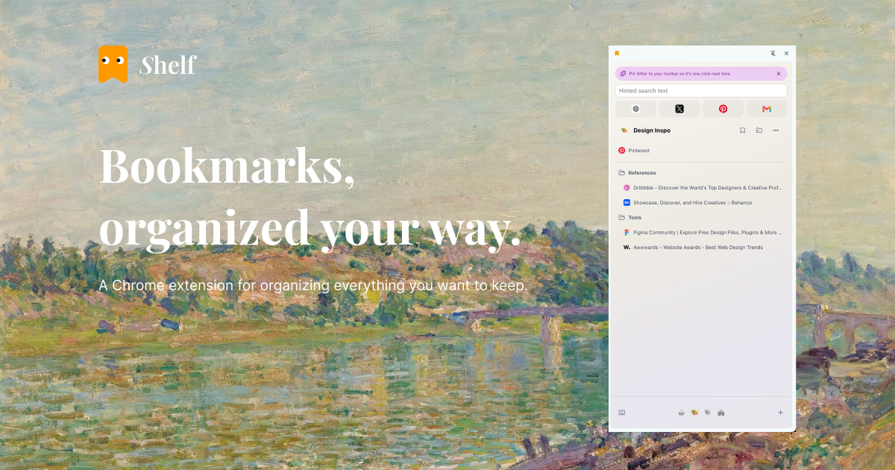
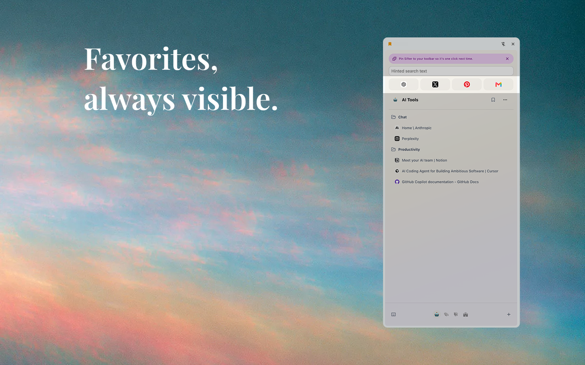
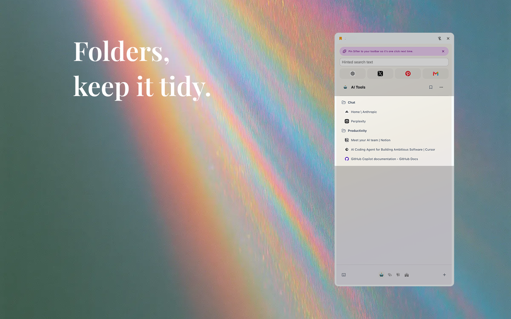
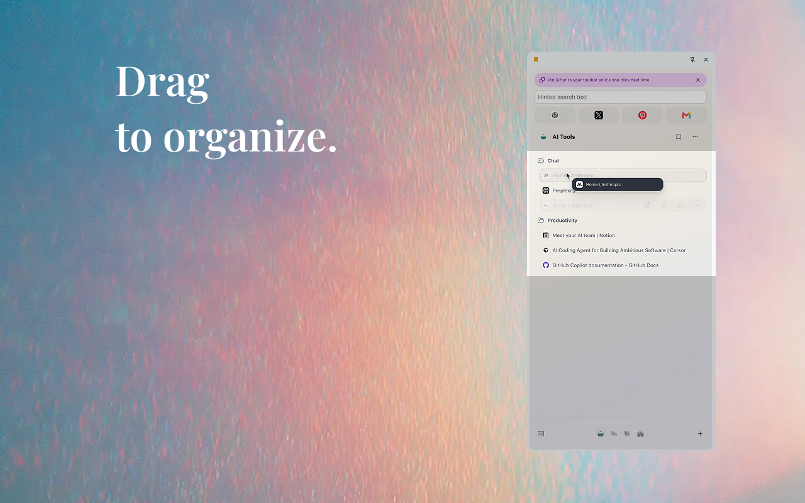
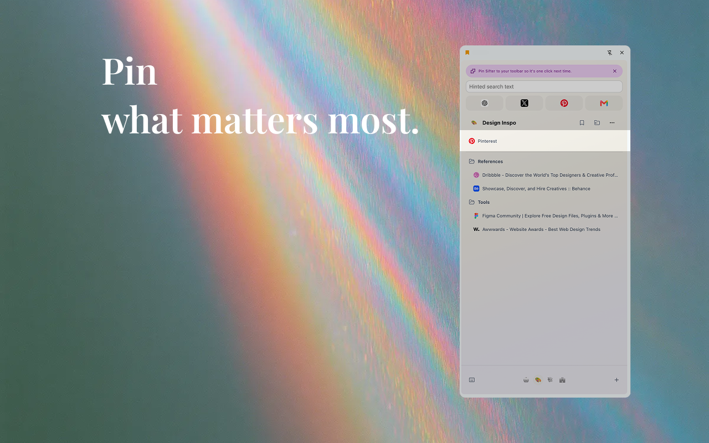

<p align="center">
  
</p>

<h1 align="center">Shelf</h1>

<p align="center"><strong>An Arc-style bookmark manager for Chrome.</strong></p>

<p align="center">
  Spaces, pinned links and favorites in Chrome's side panel — kept as your own Chrome bookmarks.
</p>

<p align="center">
  <a href="https://chromewebstore.google.com/detail/kgaehengmemalcpoabbkhgfffmecbdcf">Chrome Web Store</a> ·
  <a href="https://usecarrel.app/shelf">Website</a> ·
  <a href="https://usecarrel.app/export-arc-bookmarks">Export Arc bookmarks</a>
</p>



Shelf puts your bookmarks next to your tabs, organized into spaces you switch between from a dock — the way Arc's sidebar kept the sites you come back to, but inside the Chrome you already use.

Everything Shelf shows is an ordinary Chrome bookmark. Spaces are bookmark folders; pins and favorites are bookmarks too. They sync with your Google account like any other bookmark, and they stay in Chrome if you remove Shelf. There is no account, no server, and nothing to export later.

Shelf manages bookmarks, not open tabs.

## Features

- **Spaces for every context.** Work, research, side projects, travel — switch from the dock at the bottom of the panel.
- **Turn folders you already have into spaces.** Pick several at once from Settings → Turn folders into spaces, renaming them and choosing an emoji as you go.
- **Saves land next to their site.** After you save a page, Shelf offers to move it into the folder that already holds that site's bookmarks.
- **Favorites** that stay visible at the top, and **pins** for what matters right now, without moving bookmarks out of their folders.
- **Goes to tabs you already have open.** Clicking a bookmark that's open in a tab switches to it; Cmd/Ctrl-click opens a new one.
- **Search everything.** `Ctrl+Shift+K` (`Command+Shift+K` on macOS) opens Shelf straight into search.
- **Drag and drop** bookmarks and folders, including across spaces.
- **Open a whole space** as a tab group, in a new window, or in an incognito window.
- **Import from Arc.** Bring each Arc space's pinned tabs and folders, Arc's favorites, and optionally the open Today tabs into Shelf.

## Moving from Arc

Arc stops working on December 22, 2026.

- **Into Shelf:** open Settings (bottom left of the panel) → **Import from Arc**, and choose Arc's `StorableSidebar.json`. Each Arc space becomes a Shelf space. Importing again only adds what's missing.
- **Into any browser:** [usecarrel.app/export-arc-bookmarks](https://usecarrel.app/export-arc-bookmarks) turns the same file into a bookmarks file Chrome, Edge, Brave or Firefox can import. It runs in your browser; nothing is uploaded.

Arc keeps the file at `~/Library/Application Support/Arc/StorableSidebar.json` on macOS, and under `%LOCALAPPDATA%\Packages\TheBrowserCompany.Arc_…\LocalCache\Local\Arc` on Windows.

## How Shelf stores your spaces

Shelf never keeps your bookmarks anywhere but Chrome. It recognizes its own folders by a marker at the end of their names:

| Folder                                       | Name                           | Where           |
| -------------------------------------------- | ------------------------------ | --------------- |
| A space                                      | `[emoji] Name (Shelf)`         | Bookmarks Bar   |
| Home, once you rename it or give it an emoji | `[emoji] Name (Shelf\|Home)`   | Bookmarks Bar   |
| Pinned links                                 | `Pins (Shelf\|Pins)`           | Other Bookmarks |
| Favorites                                    | `Favorites (Shelf\|Favorites)` | Other Bookmarks |

Rename or delete these like any folder. If you reinstall Shelf, folders that still end in `(Shelf)` come back as spaces. Space order, colors and a few interface preferences live in Chrome's sync storage; the space you have open stays on the device.

## Privacy

Shelf sends nothing anywhere while you use it. It talks only to Chrome's bookmark, storage, tab and tab-group APIs on your device. When you remove it, Chrome opens a short page on usecarrel.app asking why; answering is optional and anonymous.

## Screenshots

|                                                  |                                              |
| ------------------------------------------------ | -------------------------------------------- |
|  |      |
|           |  |

## Install from source

Shelf targets Chrome 116 and newer.

```bash
git clone https://github.com/Hunter-Gu/Shelf.git
cd Shelf
corepack enable
pnpm install
pnpm build
```

Open `chrome://extensions`, turn on **Developer mode**, choose **Load unpacked**, and select `.output/chrome-mv3`.

## Development

```bash
pnpm install
pnpm dev
```

Load `.output/chrome-mv3-dev` as an unpacked extension. WXT rebuilds as files change; reload the extension from `chrome://extensions` when Chrome needs to pick up a manifest or background-script change.

| Command        | Purpose                             |
| -------------- | ----------------------------------- |
| `pnpm dev`     | Start the WXT development build     |
| `pnpm compile` | Type-check the project              |
| `pnpm test`    | Run the Vitest suite                |
| `pnpm build`   | Create a production build           |
| `pnpm zip`     | Package the extension for the store |

### Project layout

- `src/entrypoints/sidepanel` — the side-panel interface.
- `src/entrypoints/background.ts` — toolbar state, the keyboard command, and the uninstall page.
- `src/entrypoints/welcome`, `src/entrypoints/import-arc` — the pages opened after install and for the Arc import.
- `src/app` — hooks that keep React state in step with Chrome's APIs.
- `src/bookmark-model`, `src/workspace-model`, `src/pin-model`, `src/arc-import` — domain logic, with unit tests.
- `src/shelf-title.ts` — the `(Shelf)` folder-name format.
- `store-assets` — store listing text and artwork.

## Permissions

| Permission  | Why it is needed                                              |
| ----------- | ------------------------------------------------------------- |
| `bookmarks` | Read, create, rename, move and remove bookmarks and folders   |
| `storage`   | Keep space order, colors and interface preferences            |
| `tabs`      | Open bookmarks, switch to open tabs, and check the active tab |
| `tabGroups` | Open a space as a tab group                                   |
| `favicon`   | Show site icons from Chrome's local cache                     |
| `sidePanel` | Show Shelf in Chrome's side panel                             |

## Contributing

Issues and pull requests are welcome. Read [CONTRIBUTING.md](CONTRIBUTING.md) before starting a larger change, and report security problems as described in [SECURITY.md](SECURITY.md).

## License

[MIT](LICENSE)
