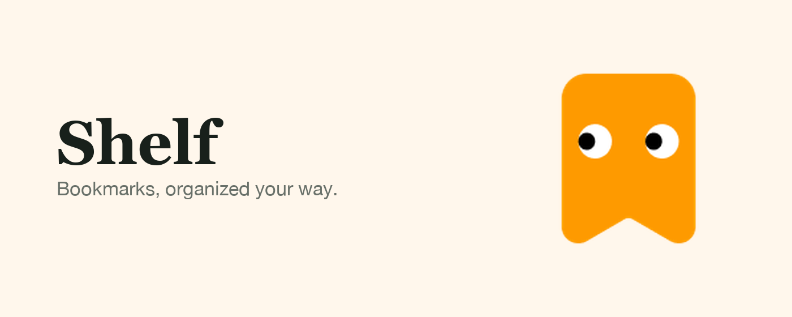
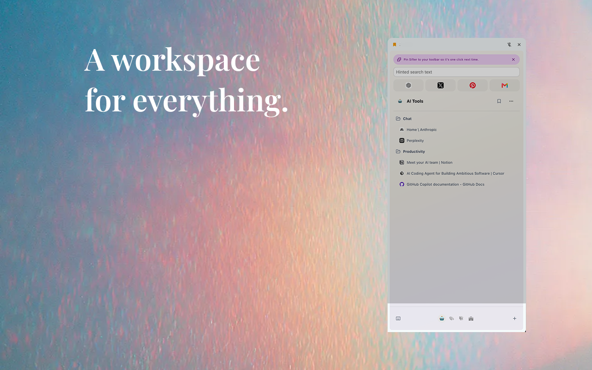

<p align="center">
  
</p>

<h1 align="center">Shelf</h1>

<p align="center"><strong>Bookmarks, organized your way.</strong></p>

<p align="center">
  An open-source Chrome side panel that turns your existing bookmarks into focused workspaces.
</p>



Shelf keeps the bookmarks you reach for close at hand without replacing Chrome's bookmark system. Organize projects into workspaces, pin important links, search instantly, and rearrange everything with drag and drop—all from the browser side panel.

If you used Arc's sidebar for spaces and pinned links, Shelf gives you the same layout in Chrome. Because every space, pin, and favorite is an ordinary Chrome bookmark, nothing is lost if Shelf ever goes away.

## Highlights

- **Workspaces for every context.** Separate work, research, travel, or anything else without maintaining another bookmark database.
- **Favorites that stay visible.** Keep a small set of frequently used links at the top of each workspace.
- **Pins for what matters now.** Promote important bookmarks without losing their place in your folders.
- **Import from Arc.** Settings → Import from Arc reads Arc's `StorableSidebar.json` and brings each space's pinned tabs and folders, Arc's favorites, and optionally the open Today tabs into Shelf.
- **Goes to tabs you already have open.** Clicking a bookmark that's open in a tab switches to it; Cmd/Ctrl-click opens a new one.
- **Drag-and-drop organization.** Move bookmarks and folders directly in the tree, including across workspaces.
- **Fast keyboard access.** Press `Ctrl+Shift+K` (`Command+Shift+K` on macOS) to open Shelf and focus search.
- **Local-first by design.** Shelf talks directly to Chrome's bookmark, storage, tab, and tab-group APIs. It has no application server or account system.

## A closer look

### Favorites, always visible


### Keep folders tidy


### Drag to organize


### Pin what matters most


### A workspace for everything



## Install from source

Shelf currently targets Chrome 116 and newer.

```bash
git clone <your-fork-or-checkout-url> Shelf
cd Shelf
corepack enable
pnpm install
pnpm build
```

Then open `chrome://extensions`, enable **Developer mode**, choose **Load unpacked**, and select `.output/chrome-mv3`.

## Development

```bash
pnpm install
pnpm dev
```

Load `.output/chrome-mv3-dev` as an unpacked extension. WXT will rebuild the extension as files change; reload the extension from `chrome://extensions` when Chrome needs to pick up a manifest or background-script change.

Useful commands:

| Command | Purpose |
| --- | --- |
| `pnpm dev` | Start the WXT development build |
| `pnpm compile` | Type-check the project |
| `pnpm test` | Run the Vitest suite |
| `pnpm build` | Create a production extension build |
| `pnpm zip` | Package the extension for distribution |

## How it works

Shelf is intentionally a single WXT extension with explicit boundaries:

- `src/entrypoints/sidepanel` mounts the React side-panel interface.
- `src/entrypoints/background.ts` owns toolbar state and extension commands.
- `src/app` contains hooks that synchronize React state with browser APIs.
- `src/bookmark-model`, `src/workspace-model`, and `src/pin-model` contain the domain logic.
- `store-assets` contains the artwork used for the extension listing and this README.

Bookmarks, pins, and favorites remain real Chrome bookmark nodes, and the folders decide which workspaces exist. Every folder Shelf owns ends in a generated marker: a workspace is `Name (Shelf)`, Home is `Name (Shelf|Home)`, and the pins and favorites folders under Other Bookmarks are `Pins (Shelf|Pins)` and `Favorites (Shelf|Favorites)`. Order, color, and pin collapse state are kept in Chrome sync storage, while the currently selected workspace stays device-local.

## Permissions

Shelf asks only for permissions used by its bookmark-manager features:

| Permission | Why it is needed |
| --- | --- |
| `bookmarks` | Read, create, rename, move, and remove bookmarks and folders |
| `storage` | Save workspace metadata and local interface preferences |
| `tabs` | Open bookmarks and inspect the active tab |
| `tabGroups` | Open a workspace as a Chrome tab group |
| `favicon` | Display site icons supplied by Chrome |

## Contributing

Issues and pull requests are welcome. Read [CONTRIBUTING.md](CONTRIBUTING.md) before starting a larger change, and report security problems according to [SECURITY.md](SECURITY.md).

## License

Shelf is available under the [MIT License](LICENSE).
